# fl-doctor

**Is FlowLink really capturing my server's traffic and sending it to the PCE? Get the answer, with evidence, in minutes.**

fl-doctor is a terminal tool (TUI + CLI) that runs on the Illumio FlowLink collector. Point it at an IP and it shows how
far that IP's flows get, step by step: on the wire → accepted by FlowLink → processed → delivered to the PCE. One static
Linux binary, no dependencies, read-only.

**[Read the documentation](https://roschereric.github.io/fl-doctor/fl-doctor-docs_en.html)** ·
[3-minute briefing](https://roschereric.github.io/fl-doctor/fl-doctor-briefing_en.html) ·
[Download](releases/)

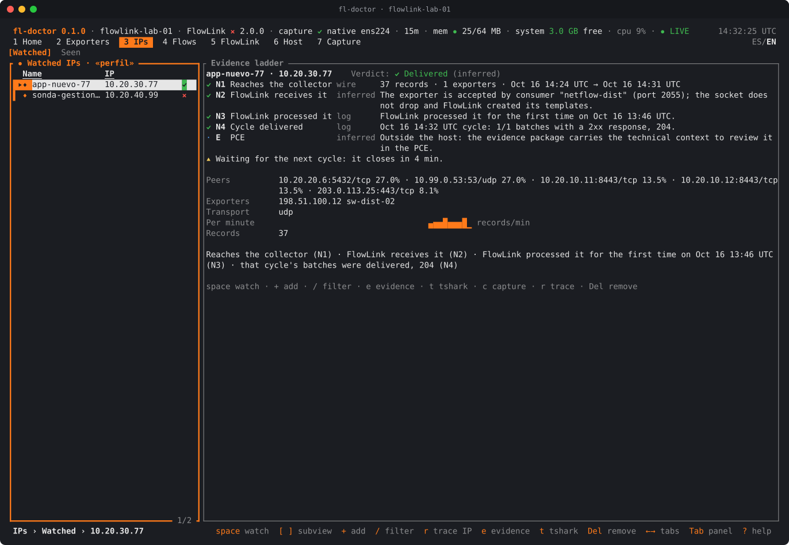

## Why fl-doctor

FlowLink is installed, the switches are exporting flows, and yet the servers you care about are **missing from the
Illumination map**. Now the hunt begins:

- Is the switch exporting at all? In which format? To which IP and port?
- Is the host firewall or `rp_filter` dropping the datagrams before FlowLink sees them?
- Is FlowLink listening on that port, and does `remote_addrs` accept that exporter?
- Did FlowLink process those records, or discard them as "bad data"?
- Did the batches actually reach the PCE, or is it failing on DNS, the proxy or TLS?
- Does the exporter even see the segment where the servers live?

Answering that usually means hours of `tcpdump` and `tshark` on the collector, reading FlowLink logs line by line,
and several rounds of questions between the network team, the Linux team, the Illumio FlowLink user and support. Every
step lives in a different tool and none of them can say *"this IP stops here, and this is why"*.

**fl-doctor puts the whole chain on one screen.** It copies the traffic the collector receives (without taking anything away
from FlowLink), decodes NetFlow v5/v9, IPFIX and sFlow, reads FlowLink's configuration, sockets and log, and joins it all
per IP and per exporter. What used to take an afternoon of guesswork becomes a one-minute check you can show to anyone.

Four real failures from the field, each one visible on fl-doctor's first screen:

| What happened | What it looked like | What fl-doctor shows |
|---|---|---|
| FlowLink never uploaded anything | "FlowLink is running, why is the map empty?" | Log: no 204 responses, DNS errors to the PCE on every cycle |
| Millions of flows dropped as "bad data" | "Our data is corrupt" | Log: the drops are 100% ICMP, not a data problem |
| The exporter sat on the wrong side of the network | "The servers never show up" | Ladder: the IP never reaches the wire (N0); the exporter does not see that segment |
| The switch exported to the wrong UDP port | "The switch says it is sending" | Exporters: datagrams arrive on a port where FlowLink does not listen |

## Validate one IP, step by step

**1. Tell fl-doctor which server you care about.** Press `+` in **IPs › Watched** and type an IP, a CIDR network or a
range (or press `Space` on any row in any view). Headless: `sudo fl-doctor trace --ip 10.20.30.77 --observe 300`.

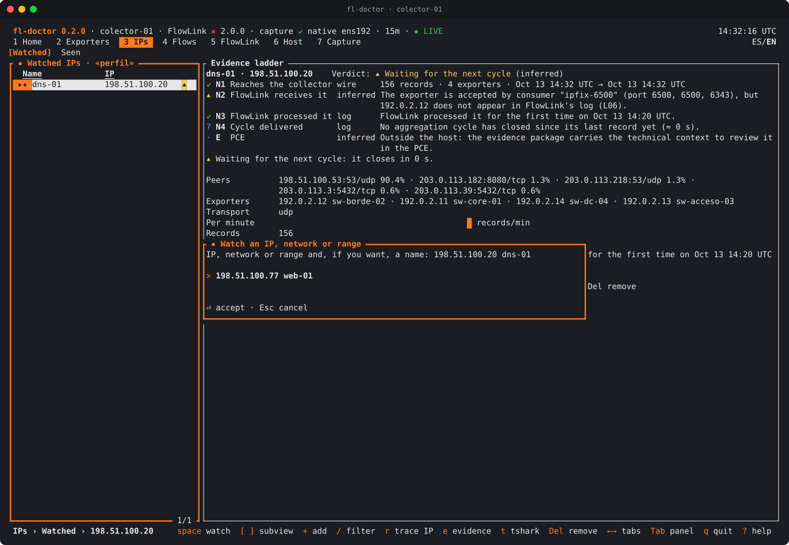

**2. Read the evidence ladder.** Each step says what was proven and where the proof comes from (capture, kernel, FlowLink
log, or inference). Here the IP reaches the collector (N1), FlowLink accepts its exporter (N2), FlowLink processed it (N3)
and the cycle that carried it was delivered to the PCE with HTTP 204 (N4). See the screenshot at the top of this page.

**3. When it does not make it, the ladder says where and why.** This IP reaches the collector, but on UDP 9995, where
FlowLink does not listen. Verdict: *FlowLink does not receive it*, with the exporter that sends it.

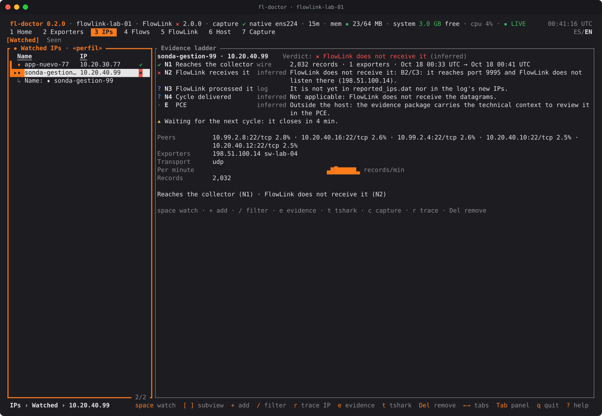

**4. Cross-check with what FlowLink itself reports.** **IPs › Seen** lists every IP seen on the wire, the exporters that
report it, and whether FlowLink has it in its own `reported_ips.dat`.

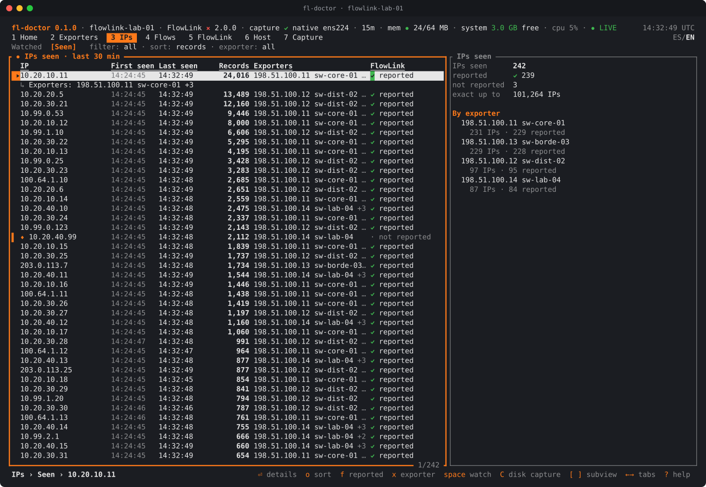

**5. Confirm that FlowLink is uploading to the PCE.** **FlowLink › Log** turns the log into a timeline: aggregation
cycles, PCE response codes, send errors (here, a DNS failure that recovered) and 17 health indicators.

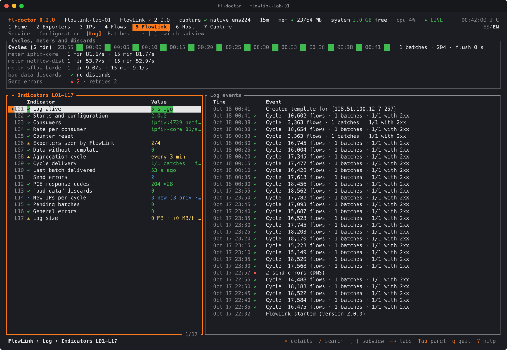

**6. Hand the evidence to support.** One key (`e`) builds a bundle: a summary in English and Spanish, the relevant log,
FlowLink's configuration with secrets hidden, and a pcap with only that IP's datagrams (original or trimmed).

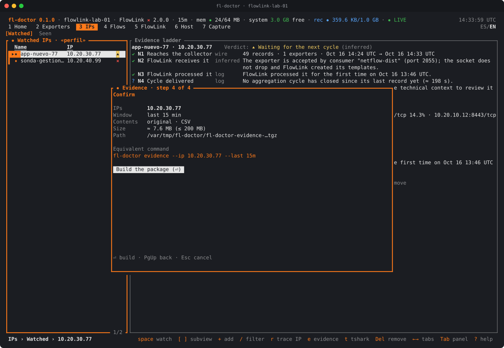

## Where does the chain break?

**Home** shows the five links (exporters, host, FlowLink, delivery, PCE) and a funnel that counts datagrams on the wire,
at the socket, decoded and delivered. The first step where the number drops is the link to fix.

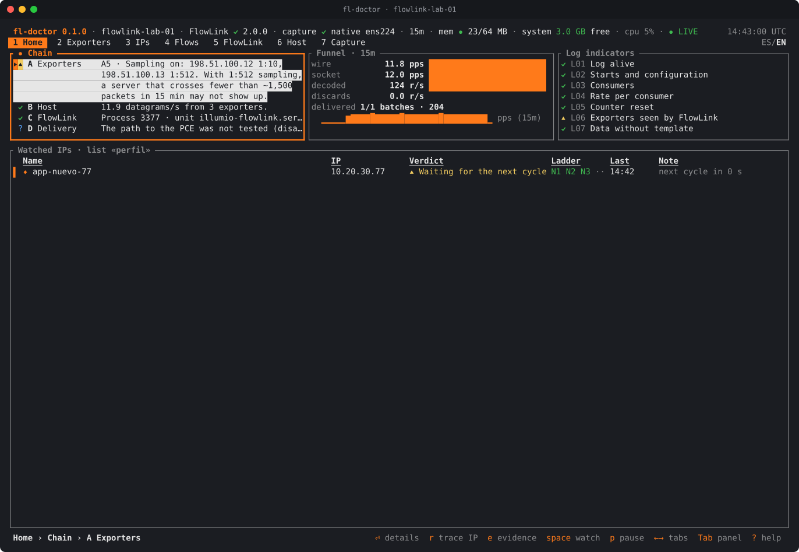

**Exporters** shows every switch or router sending flows, with version, port, templates, sampling, and whether FlowLink
accepts it: here, an exporter sending to a port with no listener.

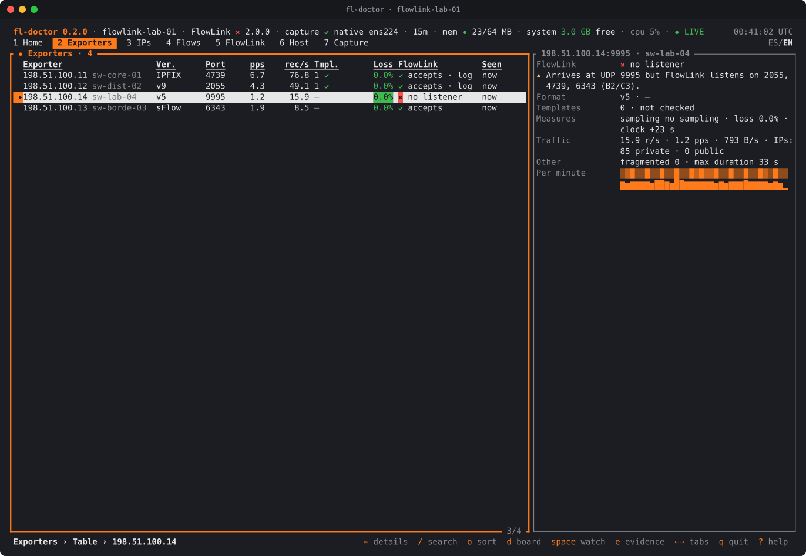

## Explore the traffic

Rank IPs by flows, see through which switches each one arrives, and filter by IP, network, exporter, port, protocol,
version or IP class from the same menu in every view.

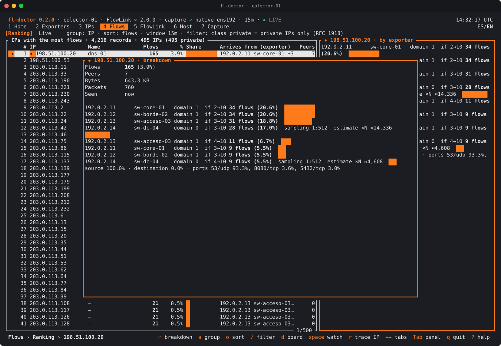

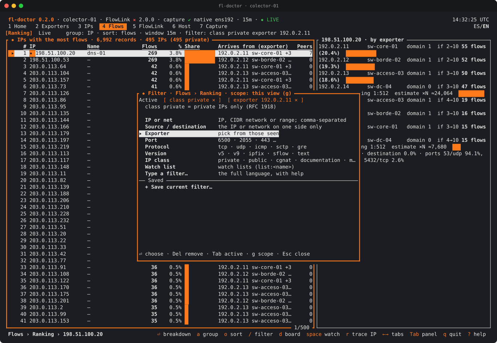

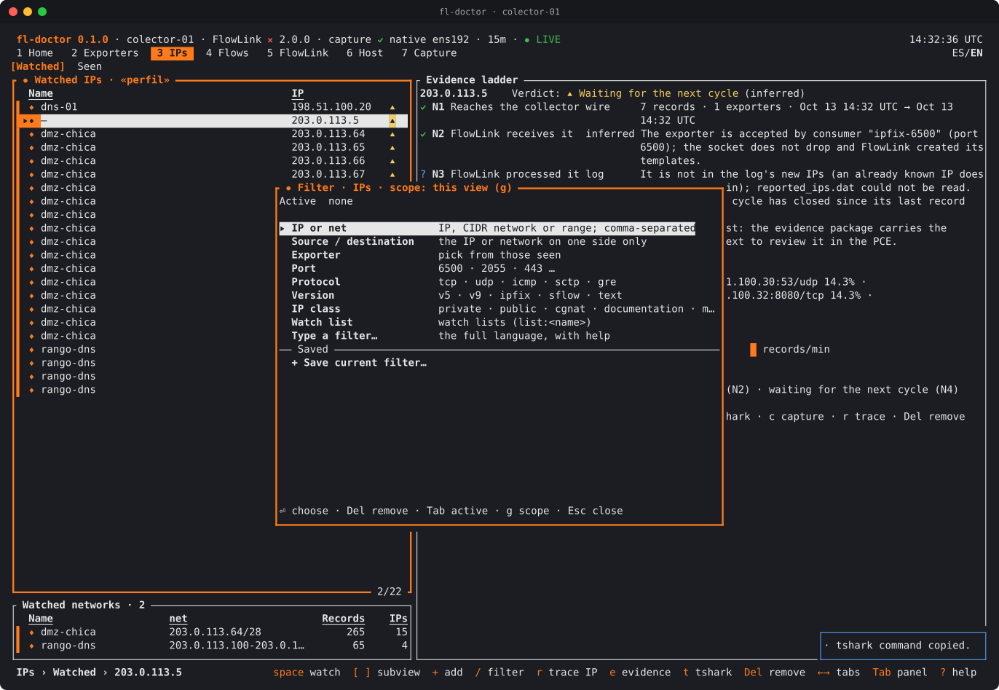

Or type a filter in the full language (`ip`, `net`, `src`, `dst`, `exporter`, `port`, `proto`, `version`, `class`,
`list:`, with `and`, `or`, `not`): it is validated as you type and tells you how many IPs match before you apply it.

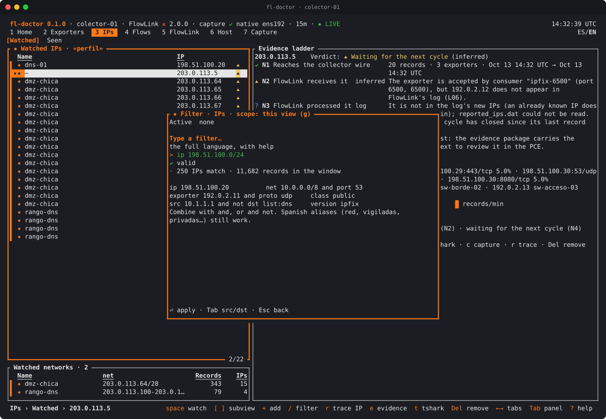

## Get it

Binaries are in [`releases/`](releases/), one folder per version, with `SHA256SUMS` and an SBOM (not signed).

```
sha256sum -c SHA256SUMS
sudo install -m 0755 fl-doctor-0.1.0-x86_64-linux /usr/local/bin/fl-doctor
sudo /usr/local/bin/fl-doctor selftest      # checks the platform; no network, no FlowLink needed
sudo /usr/local/bin/fl-doctor               # opens the TUI
fl-doctor demo                              # the TUI with synthetic data, no root (training)
```

On RHEL and derivatives `sudo` does not search `/usr/local/bin`: use the full path.

Headless, for scripts and cron (text, `--json` or `--csv`):

```
sudo fl-doctor health                                   # checks A–D and FlowLink log indicators
sudo fl-doctor trace --ip 10.20.30.77 --observe 300     # N0–N4 ladder for one IP
sudo fl-doctor top --by exporter --observe 120          # who sends the most
sudo fl-doctor log --since 2h                           # cycles, responses, errors
sudo fl-doctor evidence --ip 10.20.30.77 --last 15m     # bundle for support
fl-doctor read capture.pcap --config config.yaml        # analyze a pcap on your laptop
```

## Documentation

Read it online (single pages, no download needed):

- **[Documentation](https://roschereric.github.io/fl-doctor/fl-doctor-docs_en.html)**: install, the interface and its
  controls, every tab and submenu step by step, use cases with screenshots, evidence for support, CLI reference,
  troubleshooting.
- **[Briefing](https://roschereric.github.io/fl-doctor/fl-doctor-briefing_en.html)** (3 minutes): the problem, the five
  main use cases, guarantees.

English is the reference documentation. Spanish translations:
[documentación](https://roschereric.github.io/fl-doctor/fl-doctor-docs_es.html) ·
[briefing](https://roschereric.github.io/fl-doctor/fl-doctor-briefing_es.html). The same files are in [`docs/`](docs/)
for offline use.

All screenshots use synthetic data (documentation address ranges, a lab collector and the built-in demo).

## Guarantees

- **Read-only.** It never restarts FlowLink or changes its config, the firewall, routes or `sysctl`. It writes only to
  `/var/tmp/fl-doctor/` and its own preferences.
- **Takes no packets away from FlowLink.** It copies traffic with AF_PACKET, like `tcpdump`, and never binds the
  collector's ports.
- **Sends nothing out.** No telemetry, no auto-update. The only outbound check is an optional reachability test to the
  PCE address from FlowLink's config, without credentials, repeated every 30 s while the interface is open (`--offline`
  turns it off).
- **Secrets stay hidden.** The API key is never shown; the evidence bundle redacts sensitive keys and secret-looking values
  (PEM, JWT). Nothing leaves the machine unless you copy it.
- **Light.** Fixed memory budget (32 / 64 / 256 MB profiles). Measured on Rocky 9 x86_64 replaying a real NetStream
  capture: about 22 MB (normal, with a brief startup peak of up to about 33 MB) and about 14 MB (lean), flat over time.
  Low CPU priority.
- **`sudo fl-doctor` is equivalent to root**: do not grant it in sudoers to accounts that should not have root.

## Status

**0.1.0.** Static binaries for Linux x86_64 and aarch64 (macOS for `read` and `demo`). Tested on Rocky 9 and UBI 8 and in a
Rocky 9 x86_64 VM with replayed captures. **Not yet validated on a real Illumio FlowLink user's collector; RHEL 7 is not
verified.** Release notes for each version are in its `releases/<version>/` folder.

Feedback wanted: collectors where it breaks, FlowLink versions beyond 2.0.0, exporters from other vendors.

## Disclaimer

fl-doctor is an unofficial field tool. It is **not an Illumio product**, is **not supported by Illumio**, and is provided
**"as is"**, without warranty of any kind. Use it under your own change-control process. The source code is not
published.

## Contact

Eric Roscher, Illumio LATAM Pre-Sales Engineering.
